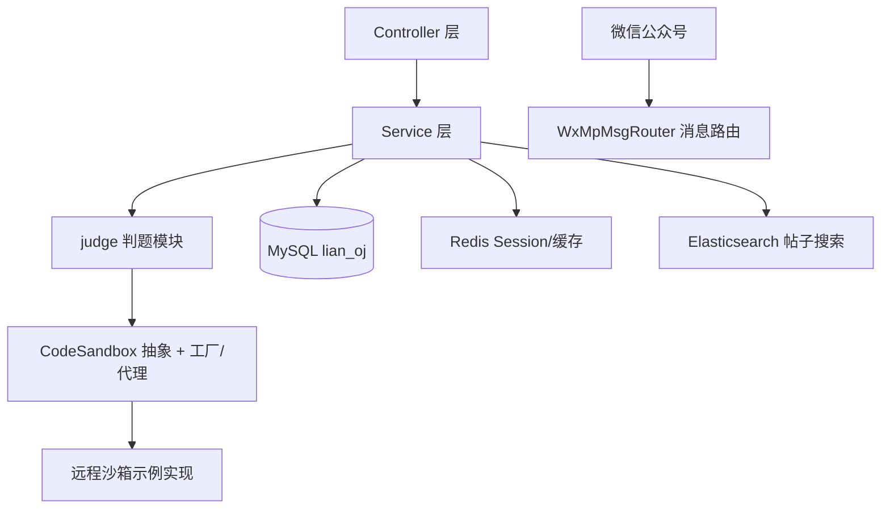

# lian-oj-backend

> lianoj 在线判题系统 · 单体版本（系统演进起点）

   

在线判题系统的第一个完整版本：单体架构下实现了用户、题目、提交判题的完整业务闭环，并扩展了帖子社区、全文搜索与微信公众号接入。判题链路（异步消息、独立沙箱、多语言、SPJ）在后续的微服务版本中重建——**本仓库保留演进起点的形态**，用于对照架构决策的前后变化。

## 功能

- **判题主线**：题目管理（题面/标签/判题配置/测试用例）、代码提交、沙箱执行、比对判题
- **帖子社区**：帖子发布、点赞、收藏，热度排行（定时任务预热缓存）
- **全文搜索**：Elasticsearch 同步与检索帖子（可切换）
- **微信公众号**：消息路由与自动回复（wx-java-mp）
- **基础设施**：Redis Session 登录态、全局异常处理、AOP 权限注解、文件上传

## 架构



包结构（按职责分包）：`controller / service / judge / manager / mapper / esdao / wxmp / job / aop / annotation / common`。

## 技术栈

| 类别 | 选型 |
| --- | --- |
| 框架 | Spring Boot 2.7.2、MyBatis-Plus 3.5.2、Spring Session Data Redis |
| 中间件 | MySQL 8、Redis、Elasticsearch（可选）、RabbitMQ 相关能力在微服务版本引入 |
| 扩展 | wx-java-mp-spring-boot-starter 4.4.0（公众号）、Knife4j 接口文档 |
| 判题 | 工厂 + 代理 + 策略模式的沙箱调用抽象（远程沙箱对接采用早期明文请求头鉴权，如对接当前版沙箱服务需适配签名协议） |

## 快速开始

```bash
# 1. 建库（含建表脚本）
mysql -uroot -p -e "CREATE DATABASE lian_oj DEFAULT CHARACTER SET utf8mb4;"
mysql -uroot -p lian_oj < sql/create_table.sql

# 2. 修改 src/main/resources/application-*.yml 中 MySQL/Redis 地址与凭据

# 3. 启动（端口 8121）
mvn spring-boot:run
```

- 接口文档：`http://localhost:8121/doc.html`
- 依赖 Redis（登录态）；Elasticsearch 与公众号为可选功能，按配置开关。

## 为什么演进到微服务（本版本的局限）

这版单体在判题链路上暴露的问题，直接催生了微服务版本的拆分决策：

| 单体局限 | 微服务版本的演进 |
| --- | --- |
| 判题是同步调用，编译执行（秒级）占住请求线程，突发提交拖慢整个应用 | 提交走 RabbitMQ 异步化，落库即返回，消费端按能力处理 |
| 判题与业务同进程，沙箱压力影响核心体验 | 判题服务独立部署扩展；沙箱彻底独立为服务并带签名鉴权 |
| 沙箱仅 Java 单语言，安全靠黑名单与 JVM 参数 | 语言注册表支持 Java/C++/Python；Docker 隔离 + 容器池 + 编译缓存 |
| 无消息可靠性语义 | 手动 ACK、死信队列、僵尸/悬挂恢复 |
| 计数、幂等、限流缺失 | 状态机条件更新抢占、Redisson 锁、双层限流 |

> 与单体共用 Redis 时注意**会话序列化契约**：单体与微服务的用户类全限定名不同，同库会互相"投毒"导致反序列化失败——应急清理会话，根治按应用隔离 Spring Session namespace。这是真实踩过并记录的坑。

演进后的版本见配套仓库。

## 配套仓库

| 仓库 | 定位 |
| --- | --- |
| `lian-oj-backend`（本仓库） | 单体版本：演进起点，含完整业务与社区功能 |
| `lianoj-backend-microservice` | 微服务后端：异步判题、状态机幂等、消息可靠性、SPJ/赛制 |
| `lianoj-code-sandbox` | 独立代码沙箱：多语言、Docker 隔离、签名鉴权、容器池与编译缓存 |
